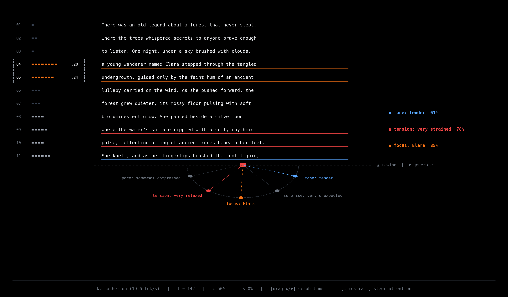
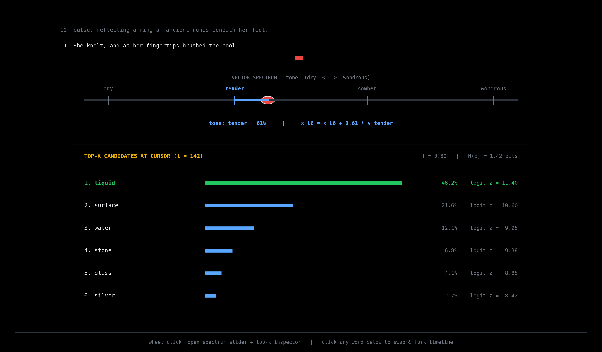
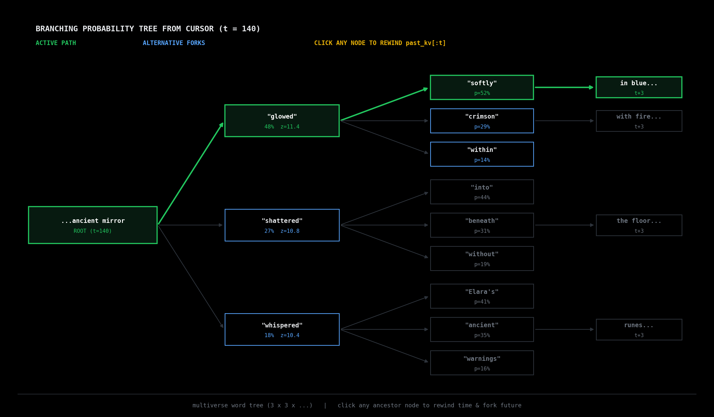

<div align="center">

# ⚡ LLM Engineering Lab
### *Building Modern Large Language Models & Post-Training Systems from Scratch in Pure PyTorch*

[](https://www.python.org/)
[](https://pytorch.org/)
[](https://opensource.org/licenses/MIT)
[](https://github.com/elham715/llm-engineering-lab)
[](https://github.com/elham715/llm-engineering-lab/pulls)
[](https://github.com/elham715/llm-engineering-lab/stargazers)

<p align="center">
  <b>A zero-black-box systems repository implementing the complete modern LLM stack from silicon hardware physics up to post-training alignment — with zero external library abstractions.</b>
</p>

[Architecture](#-architectural-roadmap) • [ChronoSteer Studio](#-chronosteer-studio-interactive-mechanistic-steering) • [Hardware Cheatsheet](#-silicon--hardware-first-principles-cheatsheet) • [Quickstart](#-quickstart--run-unit-tests) • [License](#-license)

</div>

---

## 🌟 Why This Repository Exists

Most machine learning repositories in the wild fall into the **"HuggingFace Wrapper Trap"**:
```python
# The industry standard (Surface-level understanding)
from transformers import AutoModelForCausalLM, Trainer
model = AutoModelForCausalLM.from_pretrained("meta-llama/Llama-3-8B")
# Zero understanding of memory bandwidth, KV cache scaling, or RoPE rotations!
```

This laboratory takes the **first-principles path**:
* **Zero HuggingFace abstractions for core algorithms**: Every matrix contraction, positional rotation, and loss function is implemented in raw PyTorch.
* **Hardware-Grounded Silicon Physics**: Memory bandwidth bottlenecks ($GEMM$ vs $GEMV$), SRAM vs VRAM latency, and FP32 numerical overflow guards.
* **Production-Grade Verification**: 21+ unit tests testing **mathematical invariants** (scale invariance of RMSNorm, relative rotational invariance of RoPE, step-0 identity of LoRA, and analytical Bradley-Terry gradient dynamics).
* **Interactive Mechanistic Interpretability**: A live WebSocket-powered steering studio ([ChronoSteer](#-chronosteer-studio-interactive-mechanistic-steering)) for time-travel KV rewind and contrastive activation steering.

---

## 🔬 Architectural Roadmap

| # | Project | Mathematical & Systems Core | Status | Test Harness |
|---|---|---|:---:|:---:|
| **01** | [`01_gpt2_from_scratch/`](01_gpt2_from_scratch/) | **Full GPT-2 (124M) Engine**: Causal Multi-Head Attention, `Conv1D` weight transfer from OpenAI checkpoints, semantic weight tying, and Top-K/Top-p nucleus sampling. | **Verified** 🟢 | [test_model.py](01_gpt2_from_scratch/test_model.py) |
| **02** | [`02_chronosteer_studio/`](02_chronosteer_studio/) | **ChronoSteer Studio**: Real-time glass-box steering engine (`torch.bfloat16` CPU + Starlette WebSockets). Dynamic KV-cache time-travel rewind, Layer-6 contrastive residual steering, and 360° future-word wheel. | **Verified** 🟢 | Live Web GUI |
| **03** | [`03_bpe_tokenizer/`](03_bpe_tokenizer/) | **Byte-Level BPE Tokenizer**: 256-byte UTF-8 base vocab, iterative pair frequency counting, regex pre-tokenization, zero `<unk>` guarantee, verified round-trip on Bengali, biochemical sequences, and emojis. | **Verified** 🟢 | [test_bpe.py](03_bpe_tokenizer/test_bpe.py) |
| **04** | [`04_modern_architecture_gqa_rope/`](04_modern_architecture_gqa_rope/) | **LLaMA-3 / Mistral Backbone**: Rotary Position Embeddings (RoPE $\langle R_m q, R_n k \rangle = g(m-n)$), scale-invariant RMSNorm ($c \cdot x \equiv x$), SwiGLU gating ($\lfloor \frac{8}{3}d \rfloor$), and Grouped-Query Attention with zero-copy broadcasting. | **Verified** 🟢 | 6/6 Passing |
| **05** | [`05_lora_peft_from_scratch/`](05_lora_peft_from_scratch/) | **Parameter-Efficient LoRA & QLoRA NF4**: $W_0 + \frac{\alpha}{r} (B A)$ with $B=0$, associative matrix memory trick $(x A^T) B^T$ ($O(r)$ memory), zero-latency weight merging, and 16-quantile NormalFloat4 quantization. | **Verified** 🟢 | 6/6 Passing |
| **06** | [`06_preference_optimization_dpo/`](06_preference_optimization_dpo/) | **Direct Preference Optimization (DPO)**: Closed-form Bradley-Terry preference loss, analytical partition function $Z(x)$ cancellation, autoregressive target shift (`:-1` vs `1:`), and prompt masking (`-100`). | **Verified** 🟢 | 5/5 Passing |
| **07** | [`07_inference_kvcache_speculative_decoding/`](07_inference_kvcache_speculative_decoding/) | **High-Throughput Inference Engine**: Dynamic zero-reallocation static KV cache and Leviathan/Chen Speculative Decoding with rejection sampling for $2\times\text{–}3\times$ speedup while preserving target distribution. | **Verified** 🟢 | 4/4 Passing |

---

## 🧬 Sister Research Laboratories: Bio-ML, Genomics & Computational Oncology

> Exploring the intersection of Transformer Attention Mechanics, Structural Biochemistry, Non-coding Genomics, and Metabolic Dynamics:

* **[`oncogenic-attention-disruption`](https://github.com/elham715/oncogenic-attention-disruption)**:
  * **ESM-2 Mechanistic Attention Disruption in Oncogenic Kinases**: Quantifying drug resistance in human EGFR ($C797S$, Osimertinib covalent anchor loss) directly through Meta's ESM-2 Transformer attention maps ($\Delta \mathbf{A}_{ij}$) and crystallographic PDB `2J6M` $C_\alpha$ distance alignment ($r_s = 0.4464$).
* **[`cross-attention-drug-synergy`](https://github.com/elham715/cross-attention-drug-synergy)**:
  * **Bi-modal Cross-Attention for Anticancer Drug Sensitivity (PaccMann Modernization)**: Fusing small-molecule inhibitor SMILES with 128 landmark cancer genes across 8 canonical pathways to predict $\ln(\mathrm{IC}_{50})$ and visualize chemical warhead $\longleftrightarrow$ pathway cross-attention.
* **[`promoter-variant-transformer`](https://github.com/elham715/promoter-variant-transformer)**:
  * **RoPE Enformer for Non-Coding Cancer Driver Mutations**: Modeling the 512 bp human *TERT* promoter with Rotary Position Embeddings (RoPE), 4-layer 1D Conv-Transformer stem, and in silico saturation mutagenesis (ISM) capturing de novo GABP/ETS transcription factor motif creation at canonical hotspot mutations $C228T$ and $C250T$.
* **[`biopath-reaction-transformer`](https://github.com/elham715/biopath-reaction-transformer)**:
  * **Graphormer Topological Shortest-Path Distance (SPD) Attention for Metabolic Cascades**: Incorporating all-pairs Floyd-Warshall geodesic graph biases $\mathbf{B}_{\mathrm{SPD}(i,j)}$ into Multi-Head Attention to model 25 core human metabolites across Glycolysis, TCA, and the Urea cycle, predicting metabolic flux and the pathogenic $1.81\times$ surge of oncometabolite D-2-hydroxyglutarate (2-HG) triggered by *IDH1* $R132H$.

---

## 🎨 ChronoSteer Studio: Interactive Mechanistic Steering

An interactive real-time mechanistic interpretability studio built with Starlette WebSockets and high-performance PyTorch CPU execution.

<div align="center">
  
</div>

<br/>

<div align="center">
  
  
</div>

### Key Capabilities:
* **Scroll-Bounded KV-Cache Rewind**: Scrub backward in time across generated tokens without discarding compute.
* **Layer-6 Contrastive Residual Steering**: Inject directional vectors into the residual stream to steer style, toxicity, or domain specialization in real time.
* **3×3 Multiverse Branching Tree**: Simultaneously sample 9 alternative counterfactual futures at any token junction.
* **Concentric 360° Future-Word Wheel**: Visual probability distributions over the top-$K$ candidate tokens.

```bash
cd 02_chronosteer_studio
pip install -r requirements.txt
python server.py
# Open http://127.0.0.1:8765 in your browser
```

---

## 🧠 Silicon & Hardware First-Principles Cheatsheet

### 1. The 4 GPU VRAM Buckets Ledger (Why a 14 GB Model Crashes a 24 GB GPU)
During inference, you only store Weights ($2\text{ bytes}$) and KV Cache. During fine-tuning, AdamW requires **$16\text{ bytes / parameter}$**:
$$\text{VRAM}_{\text{total}} = \underbrace{\Phi \times 2\text{B}}_{\text{Model Weights}} + \underbrace{\Phi \times 2\text{B}}_{\text{Gradients}} + \underbrace{\Phi \times (4\text{B } m_t + 4\text{B } v_t + 4\text{B } W_{\text{master}})}_{\text{AdamW Monster (12B)}} + \text{Activations}$$
For a **7B parameter model**: $7 \times 10^9 \times 16\text{ bytes} \approx \mathbf{112\text{ Gigabytes of VRAM}}$!

---

### 2. The Associative LoRA Memory Law
In Low-Rank Adaptation, we compute: $y = x W_0^T + \frac{\alpha}{r} x (B A)^T = x W_0^T + \frac{\alpha}{r} (x A^T) B^T$
```
Naive Order:       x @ (B @ A).T   ---> Materializes full [4096 x 4096] matrix (O(d^2) memory!)
Senior Engineer:  (x @ A.T) @ B.T  ---> Intermediate activation shape is [B, T, 8] (O(r) memory!)
```
*(Intermediate activation tensor is **512× smaller**, preventing out-of-memory errors on consumer GPUs).*

---

### 3. DPO Closed-Form Partition Function Cancellation
Classical RLHF (PPO) requires 4 models in memory ($\pi_\theta, \pi_{\text{ref}}, r_\psi, V_\phi$) and collapses easily. DPO reparameterizes the reward model directly through the optimal policy:
$$r(x, y) = \beta \log \frac{\pi^*(y \mid x)}{\pi_{\text{ref}}(y \mid x)} + \beta \log Z(x)$$
When evaluating the win probability between chosen $y_w$ and rejected $y_l$:
$$P(y_w \succ y_l \mid x) = \sigma(r(x, y_w) - r(x, y_l))$$
The intractable partition function $\beta \log Z(x)$ **cancels identically to zero**:
$$\mathcal{L}_{\text{DPO}}(\theta) = -\mathbb{E}_{(x, y_w, y_l)} \left[ \log \sigma \left( \beta \left[ \log \frac{\pi_\theta(y_w \mid x)}{\pi_{\text{ref}}(y_w \mid x)} - \log \frac{\pi_\theta(y_l \mid x)}{\pi_{\text{ref}}(y_l \mid x)} \right] \right) \right]$$

---

### 4. Speculative Decoding Rejection Sampling
Converts $K$ sequential memory-bound $GEMV$ loads (1 FLOP/byte) into **1 parallel compute-bound $GEMM$ pass**:
$$\text{Acceptance Condition: } U \sim \text{Uniform}(0, 1) < \min\left(1, \frac{P_{\text{target}}(x_t)}{P_{\text{draft}}(x_t)}\right)$$
Guarantees the output token distribution is **100% mathematically identical** to the target model alone.

---

## 🚀 Quickstart & Run Unit Tests

### Clone & Install
```bash
git clone https://github.com/elham715/llm-engineering-lab.git
cd llm-engineering-lab
pip install torch
```

### Run All 21 Verified Unit Tests
Run the entire test suite in a single command:
```bash
python 04_modern_architecture_gqa_rope/test_modern_architecture.py && \
python 05_lora_peft_from_scratch/test_lora.py && \
python 06_preference_optimization_dpo/test_dpo.py && \
python 07_inference_kvcache_speculative_decoding/test_speculative.py
```

Expected output:
```
Ran 6 tests in 0.067s  OK  (RoPE, RMSNorm scale invariance, SwiGLU, GQA)
Ran 6 tests in 0.215s  OK  (LoRA step-0 B=0, Associative math, NF4 quantiles)
Ran 5 tests in 0.039s  OK  (DPO ln(2) boundary, Monotonic margin, Masking)
Ran 4 tests in 0.015s  OK  (KV cache static slices, Speculative rejection)
========================================================================
TOTAL: 21 PASSED, 0 FAILED
```

---

## 📈 Star History

[](https://star-history.com/#elham715/llm-engineering-lab&Date)

---

## 🤝 Contributing & Community

Contributions, bug reports, and optimizations are welcome!
1. Fork the Project
2. Create your Feature Branch (`git checkout -b feature/FlashAttentionKernel`)
3. Commit your Changes (`git commit -m 'feat: add triton flash attention forward'`)
4. Push to the Branch (`git push origin feature/FlashAttentionKernel`)
5. Open a Pull Request

⭐ **If you find this repository educational or useful for your AI systems journey, please consider giving it a star!**

---

## 📜 License
Distributed under the MIT License. See [LICENSE](LICENSE) for more details.
